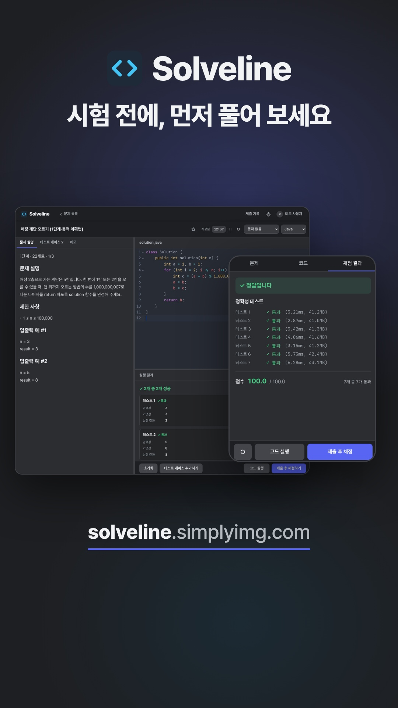

  <b>Solveline</b> — A Java and Python coding test practice environment

  
  
  

  <a href="README.md">한국어</a> | English

---

**Service**: <a href="https://solveline.simplyimg.com">https://solveline.simplyimg.com</a>

---

   
  <a href="https://www.youtube.com/shorts/HfLgXt2_xjs">▶ Watch the 30-second demo (in Korean)</a>

Solveline is a web IDE that puts the problem statement, code editor and run results on one screen, like a real coding test, and runs and grades Java and Python code.
Anyone can browse the problems. Sign up with a Google account to write, run and grade code and keep a record of your solutions. The service, its problems and the demo video are in Korean.

Key features:

* **Function problems**: Calls `class Solution { ... solution(...) }` or `def solution(...)` for each test case and compares the return value with the expected value, including its type. Enter inputs in the notation coding tests usually use, such as `[1, 2]`, `"abc"` and `[["a", 1]]`.
* **Standard I/O problems**: Runs `main` or a script with the given input and compares the output, as in PCCE and other I/O problems.
* **Run code / submit for grading**: Running code uses the visible cases and shows the input, expected value and output. Submitting uses the hidden cases and shows only pass/fail, time, memory and the score.
* **Shared problem sets and collections**: Everyone sees the same problems, grading cases and collections. Only users with edit permission can change them, and changes apply to everyone. A `/` in a collection name creates a hierarchy (for example `모의고사/1회`, as in Vaultwarden). The first screen shows collections as cards, and opening a parent group shows the problems of its child collections together.
* **Personal records and folders**: Your code, your test cases, memos, solving time, grading results and folders (your own way of organizing problems) are stored per account. You start with a default folder layout.
* **Autosave**: Code, your cases and memos are kept on the device first. Only the changes sync to the server after 5 seconds without typing or after 30 seconds of continuous typing. Drafts for the same account are restored after a reload or a network failure.
* **Isolated execution**: User code runs under a lower-privilege uid in a runner container with no internet access.
* **Google login**: Both login and sign-up use a Google account. First-time users go through a consent screen (age 14 or older, terms of service, personal data collection and use).
* **Admin mode** (`/admin`): Opens only with the master password. Admins can view the user list and details, grant or revoke edit permission, open or close new sign-ups, and delete users.
* **Phones and tablets**: Every feature works on iPhone, Galaxy and iPad. On a phone, the problem screen splits into problem, code and result tabs, with the run and submit buttons at the bottom. While you write code (with the keyboard open), the tabs and buttons hide so the code fills the screen. Long lines wrap to their indentation, a handle on the right moves quickly through long code, and a two-finger pinch changes the font size. Tablets (768px wide or more) use the side-by-side desktop layout.
* **Runtimes**: Java (OpenJDK 21.0.2), Python 3.13.13.

## Documentation

These documents are in Korean.

| Document | Contents |
|---|---|
| [Development guide](docs/development.md) | Requirements, installation, environment variables and secrets, local run, stack, workflow |
| [API](docs/api.md) | Endpoint list, access permissions |
| [Architecture and deployment](docs/architecture.md) | Runtime environment, deployment layout, grading flow, renaming history |
| [Decision records](docs/decisions) | Sandbox, grading pipeline, login and permissions, and more |
| [Problem bank MCP](docs/daily-bank-mcp.md) | MCP server that lets agents build daily mini problems: design, connection, scheduled generation (Korean) |
| [Roadmap](docs/roadmap.md) | Upcoming work |
| [Quality engineering](docs/quality/README.md) | Test strategy, quality metrics, team adoption guide, automation (Playwright API and UI), SonarQube, CI (GitHub Actions) |
| [AGENTS.md](AGENTS.md) | Working rules for people and agents |

---
